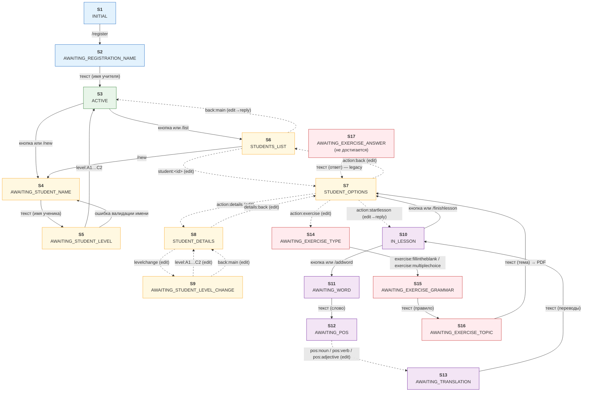

# Chatbot State Machine

## Описание состояний

| # | Состояние | Назначение | Как попадаем | Как выходим |
|---|-----------|------------|--------------|-------------|
| S1 | `INITIAL` | Пользователь открыл бота, но не зарегистрирован | Автоматически при первом входе | `/register` → S2 |
| S2 | `AWAITING_REGISTRATION_NAME` | Ожидание имени учителя | Из S1 по `/register` | Ввод имени → S3 |
| S3 | `ACTIVE` | Зарегистрирован, без активного урока. Idle-состояние | Из S2, S5, S6 | Кнопки/команды → S4, S6 |
| S4 | `AWAITING_STUDENT_NAME` | Ожидание имени нового ученика | Из S3 или S6 по `/new`/кнопке, из S5 при ошибке валидации имени | Ввод имени → S5 |
| S5 | `AWAITING_STUDENT_LEVEL` | Выбор CEFR-уровня нового ученика (inline-кнопки) | Из S4 вводом имени | `level:<код>` → S3 (ошибка → S4) |
| S6 | `STUDENTS_LIST` | Inline-кнопки со списком учеников | Из S3 по `/list`, из S7 по `action:back` | `student:<id>` → S7, `/new` → S4, `back:main` → S3 |
| S7 | `STUDENT_OPTIONS` | Меню действий для выбранного ученика | Из S6 по `student:<id>`, из S8/S10/S16 (legacy: S17) | `action:*` → S8/S10/S14/S6 |
| S8 | `STUDENT_DETAILS` | Карточка ученика: уровень, статистика словаря, активный урок | Из S7 по `action:details`, из S9 | `details:back` → S7, `levelchange` → S9 |
| S9 | `AWAITING_STUDENT_LEVEL_CHANGE` | Выбор нового CEFR-уровня ученика | Из S8 по `levelchange` | `level:<код>` → S8, `back:main` → S8 |
| S10 | `IN_LESSON` | Активный урок для выбранного ученика | Из S7 по `action:startlesson` | Кнопка/`/addword` → S11, кнопка/`/finishlesson` → S7 (сводка урока) |
| S11 | `AWAITING_WORD` | Шаг 1: ожидание английского слова | Из S10 по кнопке `/addword` | Ввод слова → S12 |
| S12 | `AWAITING_POS` | Шаг 2: выбор части речи (inline-кнопки) | Из S11 | `pos:noun`/`pos:verb`/`pos:adjective` → S13 |
| S13 | `AWAITING_TRANSLATION` | Шаг 3: ввод перевода | Из S12 | Ввод перевода → S10 |
| S14 | `AWAITING_EXERCISE_TYPE` | Выбор типа упражнения (inline-кнопки) | Из S7 по `action:exercise` | `exercise:*` → S15 |
| S15 | `AWAITING_EXERCISE_GRAMMAR` | Ввод грамматического правила | Из S14 | Ввод правила → S16 |
| S16 | `AWAITING_EXERCISE_TOPIC` | Ввод темы упражнения; генерация + PDF | Из S15 | Ввод темы → генерация PDF → S7 |
| S17 | `AWAITING_EXERCISE_ANSWER` | Ожидание ответа на упражнение (интерактивный режим) | — в текущем PDF-потоке **не достигается** (см. примечание) | Ввод ответа → S7 |

> **Примечание к S17.** Переход `InputAwaitingExerciseAnswerTransition` и дефолтный `Handler`
> зарегистрированы, но ни один переход больше не переводит чат в `AWAITING_EXERCISE_ANSWER`:
> интерактивный поток заменён отправкой упражнения PDF-документами (S16 → S7). Состояние и логика
> `CheckExercise` сохранены как задел на будущее; при отсутствии `exerciseId` в контексте переход
> возвращает «Упражнение не найдено» и уводит в S7.

## Конфиг состояний

Каждое состояние определяет, какие триггеры обработаны переходами; всё остальное уходит
в дефолтный `Handler` состояния.
**Типы триггеров** (`Action`): команда (`BOT_COMMAND`), reply-кнопка (текст из `Buttons.REPLY_BUTTONS`),
ввод (свободный текст), callback (inline-кнопка, префикс `prefix:payload`).

| # | Состояние | Команды | Кнопки (reply) | Ввод | Callback |
|---|-----------|---------|----------------|------|----------|
| S1 | `INITIAL` | `/register` → S2, `/start`,`/help` → приветствие | — | дефолт | — |
| S2 | `AWAITING_REGISTRATION_NAME` | дефолт | — | ✅ `RegisterTeacher` → S3 | — |
| S3 | `ACTIVE` | `/new` → S4, `/list` → S6, `/help`,`/start` → меню | «➕ Новый студент» → S4, «👥 Мои студенты» → S6 | дефолт | — |
| S4 | `AWAITING_STUDENT_NAME` | дефолт | — | ✅ сохранить `pendingStudentName` → S5 | — |
| S5 | `AWAITING_STUDENT_LEVEL` | дефолт | — | дефолт | `level:<A1…C2>` → `CreateStudentWithDictionary` → S3 (ошибка валидации → S4); неизвестный payload → подсказка |
| S6 | `STUDENTS_LIST` | `/new` → S4, `/list`,`/help` → обновить список | — | дефолт | `student:<id>` → S7, `back:main` → S3 |
| S7 | `STUDENT_OPTIONS` | дефолт | — | дефолт | `action:startlesson` → S10, `action:details` → S8, `action:exercise` → S14, `action:back` → S6 |
| S8 | `STUDENT_DETAILS` | дефолт | — | дефолт | `details:back` → S7, `levelchange` → S9 |
| S9 | `AWAITING_STUDENT_LEVEL_CHANGE` | дефолт | — | дефолт | `level:<A1…C2>` → `ChangeStudentLevel` → S8, `back:main` → S8 |
| S10 | `IN_LESSON` | `/addword` → S11, `/finishlesson` → S7 (сводка урока), `/help` → подсказка | «➕ Добавить слово» → S11, «🏁 Завершить урок» → S7 | дефолт | — |
| S11 | `AWAITING_WORD` | дефолт | — | ✅ сохранить `wordValue` → S12 | — |
| S12 | `AWAITING_POS` | дефолт | — | дефолт | `pos:noun`/`pos:verb`/`pos:adjective` → S13 |
| S13 | `AWAITING_TRANSLATION` | дефолт | — | ✅ `AddWordToDictionary` + `AddWordToLesson` → S10 | — |
| S14 | `AWAITING_EXERCISE_TYPE` | дефолт | — | дефолт | `exercise:fillintheblank`, `exercise:multiplechoice` → S15 |
| S15 | `AWAITING_EXERCISE_GRAMMAR` | дефолт | — | ✅ сохранить `grammarRule` → S16 | — |
| S16 | `AWAITING_EXERCISE_TOPIC` | дефолт | — | ✅ `GenerateExercise` + `GenerateExercisePdf` → S7 (документы) | — |
| S17 | `AWAITING_EXERCISE_ANSWER` | дефолт | — | ✅ `CheckExercise` → S7 (сейчас не достигается) | — |

Один `Transition` может регистрироваться под несколькими ключами (например, `FinishLessonInLessonTransition`
под кнопку **и** команду в S10; `NewStudentTransition` — в S3 и S6) — такие общие переходы лежат
в корне пакета `transition/`.

### Дефолтные Handler'ы

Любой триггер, для которого в состоянии нет перехода, обрабатывается дефолтным `Handler`:

| Состояние | Ответ |
|-----------|-------|
| S1 `INITIAL` | «Добро пожаловать! Для начала зарегистрируйтесь: /register» |
| S2 `AWAITING_REGISTRATION_NAME` | «Введите ваше имя» |
| S3 `ACTIVE` | «Неизвестная команда. /help — список команд» |
| S4 `AWAITING_STUDENT_NAME` | «Введите имя ученика» |
| S5 `AWAITING_STUDENT_LEVEL` | «Выберите уровень ученика (CEFR):» |
| S6 `STUDENTS_LIST` | «Выберите ученика кнопками ниже» |
| S7 `STUDENT_OPTIONS` | «Используйте кнопки ниже» |
| S8 `STUDENT_DETAILS` | «Используйте кнопки ниже» |
| S9 `AWAITING_STUDENT_LEVEL_CHANGE` | «Выберите новый уровень (CEFR):» |
| S10 `IN_LESSON` | «Используйте кнопки ниже» |
| S11 `AWAITING_WORD` | «Введите слово на английском» |
| S12 `AWAITING_POS` | «Выберите часть речи кнопками ниже» |
| S13 `AWAITING_TRANSLATION` | «Введите переводы через запятую» |
| S14 `AWAITING_EXERCISE_TYPE` | «Выберите тип упражнения кнопками ниже» |
| S15 `AWAITING_EXERCISE_GRAMMAR` | «Введите грамматическое правило» |
| S16 `AWAITING_EXERCISE_TOPIC` | «Введите тему упражнения» |
| S17 `AWAITING_EXERCISE_ANSWER` | «Введите ваш ответ на упражнение» |

## Принцип работы

### Обработка Update (`EnglishTutorBot.onUpdateReceived`)

```
skip my_chat_member                       // служебные update (кик, смена статуса) игнорируются
chatId  = extractChatId(update)
chat    = chatService.getOrCreate(chatId)          // load
action  = updateParser.parseUpdate(update)         // Update -> Action
indicator = showProcessingIndicator(chat, action)  // только S16 + ввод: «⏳ Генерирую упражнение…»
oldState = chat.getState()
result  = stateMachine.applyAction(chat, action)   // переход или дефолтный Handler
newState = chat.getState()
deleteProcessingIndicator(indicator)               // удалить сообщение-индикатор
chatService.save(chat)                             // save — в вызывающем коде, не в машине
cleanupMessageId -> DeleteMessage                  // TextWithReplyKeyboard: удалить старое inline-сообщение
send documents / convert -> SendMessage | EditMessageText | DeleteMessage | SendDocument
send / edit / delete
```

Особенности:

- **Индикатор длительной операции.** Перед вводом темы в S16 бот отправляет «⏳ Генерирую
  упражнение…» и удаляет это сообщение после завершения генерации.
- **`cleanupMessageId`** в `TextWithReplyKeyboard`: при возврате на reply-экран (например,
  `back:main` из S6 или `action:startlesson` из S7) старое сообщение с inline-клавиатурой удаляется.
- **Удаление reply-клавиатуры.** При выходе из `ACTIVE`/`IN_LESSON` (смена oldState→newState)
  конverter помечает новую клавиатуру как замену reply-клавиатуры (`shouldRemoveReplyKeyboard`).
- **`SendDocuments`**: документы (PDF упражнения + PDF ответов) отправляются по одному, затем —
  текст «Ученик: {name}» с inline-клавиатурой меню ученика.

`StateMachine.applyAction` — чистая маршрутизация: по типу действия выбирается таблица
переходов (`commandTransitions` / `buttonTransitions` / `callbackTransitions` по ключу
`(state, триггер)`, `inputTransitions` по `state`). Переход не найден → дефолтный `Handler`
состояния, чат не меняется.

### Формирование ответа

Ответ возвращает сам переход (`ActionResult`): текст, inline- или reply-клавиатура, редактирование
сообщения (`EditMessageText` c `messageId` из callback), удаление или отправка документа
(`SendDocument`/`SendDocuments` — fileName + содержимое + caption). Билдеры ответов —
статические классы `view/*View`, тексты — `view/Messages`.

| Состояние | Экран |
|-----------|-------|
| S1 `INITIAL` | «Добро пожаловать! Для начала зарегистрируйтесь: /register» |
| S2 `AWAITING_REGISTRATION_NAME` | «Введите ваше имя» |
| S3 `ACTIVE` | «Главное меню» + Reply-кнопки: [➕ Новый студент] [👥 Мои студенты]. При переходе в S3 из inline-экранов старое сообщение удаляется (`cleanupMessageId`) |
| S4 `AWAITING_STUDENT_NAME` | «Введите имя нового ученика» |
| S5 `AWAITING_STUDENT_LEVEL` | «Выберите уровень ученика (CEFR):» + inline-кнопки [A1] [A2] [B1] / [B2] [C1] [C2] |
| S6 `STUDENTS_LIST` | «Ваши ученики:» + inline-кнопки с именами + [◀ Back] (`back:main`); пустой список → «У вас пока нет учеников» |
| S7 `STUDENT_OPTIONS` | «Ученик: {name}» + inline-кнопки: [▶ Start Lesson] [📋 Details] [🎯 Exercise] [◀ Back]. Редактируется (EditMessageText) при переходах из S6/S8/S10/S16/S17 |
| S8 `STUDENT_DETAILS` | Карточка: 🧑‍🎓 имя, 📊 уровень, 📚 статистика словаря (всего / новые / в процессе / выучено), наличие активного урока + кнопки [🔄 Изменить уровень] [◀ Back] |
| S9 `AWAITING_STUDENT_LEVEL_CHANGE` | «Выберите новый уровень (CEFR):» + inline-кнопки уровней + [◀ Back] |
| S10 `IN_LESSON` | «Урок начат для {name}!» + Reply-кнопки: [➕ Добавить слово] [🏁 Завершить урок]. Завершение → сводка «🏁 Урок завершён!» (дата, длительность в минутах, слова урока) + inline-меню ученика |
| S11 `AWAITING_WORD` | «Введите слово на английском» |
| S12 `AWAITING_POS` | «Слово: {word}» + «Выберите часть речи:» + inline-кнопки [📛 Noun] [🏃 Verb] [🎨 Adjective] |
| S13 `AWAITING_TRANSLATION` | «Слово: {word} / Часть речи: {pos} / Введите переводы через запятую (например: дом, здание, строение)» (edit сообщения S12) |
| S14 `AWAITING_EXERCISE_TYPE` | «Выберите тип упражнения:» + кнопки [✏️ Fill in the blank] [🔤 Multiple choice] (edit) |
| S15 `AWAITING_EXERCISE_GRAMMAR` | «Введите грамматическое правило (например, 'Past Simple')» |
| S16 `AWAITING_EXERCISE_TOPIC` | «Введите тему упражнения (например, 'Animals')»; при вводе — «⏳ Генерирую упражнение…», затем два PDF-документа (упражнение + ответы, из модуля `generator`) и сообщение «Ученик: {name}» с меню ученика. Ошибка PDF → «⚠️ Не удалось сформировать PDF упражнения» + меню ученика |
| S17 `AWAITING_EXERCISE_ANSWER` | (не достигается) текст упражнения + «✍️ Введите ваш ответ:» |

## Граф переходов



Переходы, отмеченные `(edit)` (пунктирные стрелки), переиспользуют существующее сообщение
(`EditMessageText`). Переходы `(edit→reply)` удаляют старое inline-сообщение
(`cleanupMessageId`) и отправляют новое с reply-клавиатурой.

## Контекст состояния (Map<String, Object>)

Типизированные ключи — enum `ContextKey` (`domain.chat`); временный ключ `pendingStudentName`
пока заводится «сырой» строкой.

| Состояние | Ключи |
|-----------|-------|
| S3 `ACTIVE` | `TEACHER_NAME` |
| S4 `AWAITING_STUDENT_NAME` | `pendingStudentName` (после ввода) |
| S5 `AWAITING_STUDENT_LEVEL` | `pendingStudentName` (удаляется после создания ученика) |
| S6 `STUDENTS_LIST` | — |
| S7 `STUDENT_OPTIONS` | `SELECTED_STUDENT_ID`, `SELECTED_STUDENT_NAME` |
| S8 `STUDENT_DETAILS` | те же |
| S9 `AWAITING_STUDENT_LEVEL_CHANGE` | те же |
| S10 `IN_LESSON` | + `ACTIVE_LESSON_ID` |
| S11 `AWAITING_WORD` | + `WORD_VALUE` (после ввода) |
| S12 `AWAITING_POS` | + `WORD_POS` (после выбора) |
| S13 `AWAITING_TRANSLATION` | `WORD_VALUE`, `WORD_POS` |
| S14 `AWAITING_EXERCISE_TYPE` | `SELECTED_*`; после выбора — `EXERCISE_TYPE` |
| S15 `AWAITING_EXERCISE_GRAMMAR` | + `GRAMMAR_RULE` (после ввода) |
| S16 `AWAITING_EXERCISE_TOPIC` | `EXERCISE_TYPE`, `GRAMMAR_RULE`; после генерации оба удаляются |
| S17 `AWAITING_EXERCISE_ANSWER` | `EXERCISE_ID`, `EXERCISE_TOPIC`, `EXERCISE_TYPE` (legacy); после проверки удаляются |

## Inline-кнопки и callback data

Константы — `view/Callbacks`, сборка данных — `ViewUtils.createCallbackData(prefix, payload)`.

| Экран | Кнопки | Callback data |
|-------|--------|---------------|
| S5/S9: уровень | `[A1] [A2] [B1] [B2] [C1] [C2]` | `level:a1` … `level:c2` |
| S6: список учеников | `[имя ученика]` ... | `student:<uuid>` |
| S6: назад | `[◀ Back]` | `back:main` |
| S7: меню ученика | `[▶ Start Lesson]` `[📋 Details]` `[🎯 Exercise]` `[◀ Back]` | `action:startlesson`, `action:details`, `action:exercise`, `action:back` |
| S8: карточка ученика | `[🔄 Изменить уровень]` `[◀ Back]` | `levelchange` (без payload), `details:back` |
| S9: назад | `[◀ Back]` | `back:main` |
| S12: часть речи | `[📛 Noun]` `[🏃 Verb]` `[🎨 Adjective]` | `pos:noun`, `pos:verb`, `pos:adjective` |
| S14: тип упражнения | `[✏️ Fill in the blank]` `[🔤 Multiple choice]` | `exercise:fillintheblank`, `exercise:multiplechoice` |
