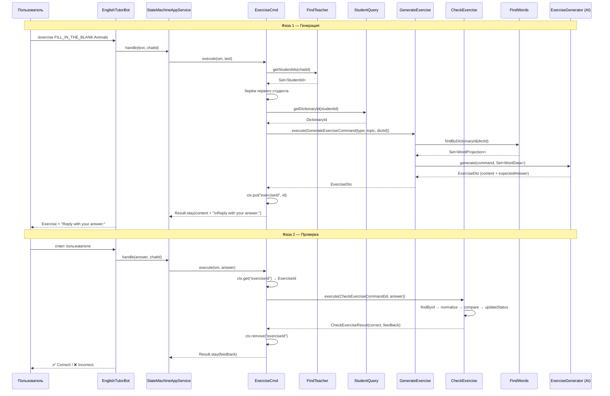

# Exercise Generation Flow

> **Актуальный флоу (v2).** После выбора типа упражнения преподаватель выбирает
> грамматическую тему: дерево каталога / 🔍 поиск / ✍️ «Своя тема» (с LLM-валидацией
> `ValidateCustomTopic`), затем — опциональный шаг тематической темы
> (`AWAITING_EXERCISE_THEMATIC_TOPIC`, свободный текст до 100 символов или «⏭ Пропустить»),
> затем выбирает слова и запускает генерацию. Тема в контракте —
> `ExerciseTopic` (`CatalogTopic(slug)` или `CustomTopic(name)`); в промпт типа вставляется
> промпт-фрагмент темы по slug через плейсхолдер `{topicGuidance}`, а в PDF/результат
> попадает готовая строка `GrammarTopicCatalog.displayTopic(...)` (путь каталога / «раздел» /
> свой текст). Тематическая тема передаётся как nullable-поле `thematicTopic` в
> `GenerateExerciseCommand`/`ExerciseDto`; при непустом значении генератор добавляет в
> user-сообщение строку `General topic: <тематика>`, а оба PDF показывают бейдж
> `Context: <тематика>` (при пропуске — ни строки, ни бейджа нет; имя PDF-файла строится
> только из грамматической темы). Ниже — прежнее описание низкоуровневых компонентов
> генерации.

## Полный цикл: от команды до ответа

### Фаза 1: Генерация

```
Пользователь → /exercise FILL_IN_THE_BLANK Animals
                  │
                  ▼
         ExerciseCmd (chatbot)
                  │
         ┌───────┼───────────┐
         │       │           │
         ▼       ▼           ▼
   FindTeacher  StudentQuery  GenerateExercise
         │       │
         │   getDictionaryId()
         │       │
         │   DictionaryId
         │       │
         └───┬───┘
             ▼
   GenerateExerciseCommand(type, topic, dictionaryId)
             │
             ▼
   GenerateExerciseUseCase
     ├── findWords.findByDictionaryId(dictId) → Set<WordProjection>
     ├── Exercise.create(id, type, topic, wordInfoIds)
     ├── generator.generate(command, Set<WordData>) → ExerciseDto (content + expectedAnswer)
     │     └── SpringAiExerciseGenerator (Spring AI, ChatClient; с fallback)
     ├── exercise.setContent(dto.content())
     ├── exercise.setExpectedAnswer(dto.expectedAnswer())
     └── ExerciseRepository.save(exercise)
             │
             ▼
   ExerciseCmd: сохраняет exerciseId в context, возвращает "Reply with your answer:"
```

### Фаза 2: Проверка ответа

```
Пользователь → текст ответа
                  │
                  ▼
         ExerciseCmd (видит exerciseId в context)
                  │
                  ▼
         CheckExerciseCommand(exerciseId, userAnswer)
                  │
                  ▼
         CheckExerciseUseCase
     ├── repository.findById(exerciseId)
     ├── exercise.markAnswered()
     ├── нормализация + сравнение с expectedAnswer
     ├── если правильно → exercise.markChecked()
     ├── repository.save(exercise)
     └── CheckExerciseResult(correct, feedback, exerciseDto)
             │
             ▼
   ✅/❌ + результат
```

## Реализованные компоненты

### Dictionary API
| Компонент | Назначение |
|-----------|-----------|
| `FindWords` | Интерфейс: `findByDictionaryId(DictionaryId) → Set<WordProjection>`, `getStats(DictionaryId) → DictionaryStats` |
| `WordProjection` | Record: `id`, `value`, `translations`, `partOfSpeech` |
| `DictionaryStats` | Record: `totalWords`, `newCount`, `inProgressCount`, `learnedCount` |
| `FindWordsService` | Реализация: достаёт Dictionary из репозитория, мапит Word → WordProjection, считает статистику |

### Exercise Module
| Компонент | Назначение |
|-----------|-----------|
| `GenerateExercise` | Интерфейс в API: `execute(GenerateExerciseCommand) → ExerciseDto` |
| `CheckExercise` | Интерфейс в API: `execute(CheckExerciseCommand) → CheckExerciseResult` |
| `GenerateExerciseCommand` | Record: `type`, `topic`, `dictionaryId` |
| `CheckExerciseCommand` | Record: `exerciseId`, `userAnswer` |
| `CheckExerciseResult` | Record: `correct`, `feedback`, `exercise` |
| `ExerciseDto` | Record: `id`, `type`, `topic`, `content`, `expectedAnswer`, `status` |
| `ExerciseType` | Enum в `api/exercise/`: `FILL_IN_THE_BLANK`, `MATCHING`, `TRANSLATION`, `MULTIPLE_CHOICE` |
| `ExerciseStatus` | Enum: `GENERATED`, `ANSWERED`, `CHECKED` |
| `GenerateExerciseUseCase` | Получает слова через `FindWords`, создаёт Exercise, вызывает генератор, сохраняет |
| `CheckExerciseUseCase` | Находит Exercise, проверяет ответ, обновляет статус |
| `ExerciseGenerator` | Порт: `generate(GenerateExerciseCommand, Set<WordData>) → ExerciseDto` |
| `WordData` | Record: `value`, `translations`, `partOfSpeech` (для передачи в AI) |
| `SpringAiExerciseGenerator` | Реальный Spring AI-адаптер: системный промпт по типу + `{topicGuidance}`-фрагмент темы + словарный блок; при ошибке LLM — fallback |

### Chatbot
| Компонент | Назначение |
|-----------|-----------|
| `ExerciseCmd` | Двухфазная команда: генерация → проверка ответа. Хранит `exerciseId` в context |
| `CommandDispatcherConfig` | Добавлены `GenerateExercise` и `CheckExercise` |
| `CommandDispatcherImpl` | Зарегистрирован `ExerciseCmd` |

### Зависимости
```java
// exercise/package-info.java
@ApplicationModule(allowedDependencies = {"dictionary :: dictionary", "dictionary :: wordInfo"})

// chatbot/package-info.java
allowedDependencies = {..., "exercise :: exercise"}
```

## Диаграмма последовательности (полный цикл)



## Что осталось доделать

> Все пункты ниже закрыты в последующих итерациях (актуальное состояние — `docs/TODO.md`):

1. ✅ **Spring AI интеграция** — `SpringAiExerciseGenerator` теперь делает реальный LLM-вызов (`#49`)
2. ✅ **Фильтр слов по статусу** — выбор слов с фильтром NEW/IN_PROGRESS/LEARNED/ALL (`#29`)
3. ✅ **Ограничить типы упражнений** — оставлены 2 типа: FILL_IN_THE_BLANK + MULTIPLE_CHOICE
4. ✅ **Выбор студента** — inline-кнопки, выбор конкретного ученика
5. ✅ **В IN_LESSON** — слова добавляются в активный урок и привязываются к словарю ученика (`#42`)
